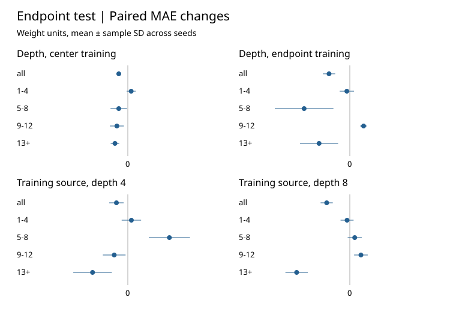

# Neural Algorithmic Reasoning

How well do graph neural networks predict weighted shortest-path distances on larger graphs or unfamiliar topologies? In this independent undergraduate research project, Zidane Boussofi tests generalization on synthetic graphs and uses a source-swap proof to show what fixed-depth message passing can distinguish.

[Research paper (PDF)](paper/neural-algorithmic-reasoning.pdf) · [LaTeX source](paper/main.tex) · [Build instructions](paper/README.md)

## Experiments

Standard and residual PyTorch models learn final distances from exact NetworkX Dijkstra labels on graphs with positive integer edge weights. Weighted distance minimizes total edge weight. Hop distance counts edges and sets the earliest round when the source flag can reach a node. Graphs are split before source queries are added.

- **Graph size and topology.** Raw mean absolute error (MAE) rose with size for all six models on connected Erdős–Rényi graphs. For the standard four-round model, normalized MAE rose from 0.323 at 8 vertices to 0.407 at 64. Diameter, hop coverage and target scale changed together. At matched sizes, errors also differed across graph families. Residual updates showed no consistent benefit under the tested protocol. [Size and topology results](docs/size-and-topology-results.md)
- **Depth and source placement.** On 24-vertex paths, eight rounds reduced overall mean MAE on both test probes under both training regimes. Parameter and dense-operation counts were close, with different widths and higher measured runtime at depth eight. Endpoint training lowered overall endpoint error and raised center error. It also shifted both hop and weighted-distance distributions. [Controlled path results](docs/path-validation-results.md)

The five paired replicates support descriptive comparisons on synthetic graphs. Final-distance supervision leaves the execution of intermediate Dijkstra or Bellman–Ford steps untested. [Scientific audit](paper/AUDIT.md)

Points show mean paired MAE changes on endpoint queries. Whiskers show one sample standard deviation across five replicates. Negative values favor depth eight or endpoint training, depending on the contrast. [Figure generation](scripts/summarize_phase4.py)

## What message passing can distinguish

The paper specializes standard message-passing locality to shortest-path prediction. For a synchronous $k$-round local model with a nodewise readout, two source placements outside a node's $k$-hop neighborhood on the same graph give identical predictions there if the source flag is the only source-dependent input. On a unit-weight path, sources at hops $k+1$ and $k+2$ differ in exact distance by one. For any parameters, the shared prediction incurs at least 0.5 weight units of absolute error on one query. [Proof and assumptions](docs/message-passing-locality.md)

## Installation and tests

Use Python 3.11 or later. The archived main runs used Python 3.12.14, PyTorch 2.15.0+cpu and NetworkX 3.4.2 with one CPU thread. Verification also used pytest 8.3.5. Replay can vary across operating systems, hardware and package versions even with the same seeds.

Create a virtual environment with **python -m venv .venv** and activate it using **.venv\Scripts\Activate.ps1** in PowerShell or **source .venv/bin/activate** in a POSIX shell.

~~~sh
python -m pip install -e ".[test,train]"
python -m pytest -q
~~~

The test extra alone suffices for the graph and exact-baseline code.

## Reproduce the experiments

From the repository root, create a fresh output directory with **mkdir replay**, then run:

~~~sh
python -m gnn_generalization.phase3 --output replay/phase3-main.jsonl --seeds 0 1 2 3 4 --epochs 12 --train-graphs 64 --eval-graphs 16
python scripts/summarize_phase3.py replay/phase3-main.jsonl
python -m gnn_generalization.phase4 replay/phase4-main.jsonl
python scripts/summarize_phase4.py replay/phase4-main.jsonl
python scripts/paper_data.py replay/phase3-main.jsonl replay/phase4-main.jsonl replay/paper-data
~~~

Phase 3 runs 30 fits and Phase 4 runs 20. The original pilot protocols can also be replayed:

~~~sh
python -m gnn_generalization.pilot --output replay/phase2-pilot.jsonl
python -m gnn_generalization.phase3 --output replay/phase3-pilot.jsonl --seeds 90 91 --epochs 2 --train-graphs 16 --eval-graphs 4
python -m gnn_generalization.phase4 replay/phase4-pilot.jsonl --pilot
~~~

Use fresh filenames for each replay. JSONL outputs record graph manifests, seeds, software versions and learning curves. Main runs also record per-node predictions and locality pairs. Summarizers write scores and plots beside their input. The original runs are kept in a private archive. The checkout includes the generated LaTeX fragments. [Archive verification and paper build](paper/README.md) · [Pilot audit](docs/phase2-pilot-audit.md)

## Licensing

The original Python source, tests, and scripts are available under the MIT License, Copyright (c) 2026 Zidane Boussofi. The research paper, LaTeX source, figures, and research documentation retain their separate copyright terms. Any future distribution of experiment data will have its own terms. Third-party materials retain their respective terms. [License](LICENSE)
